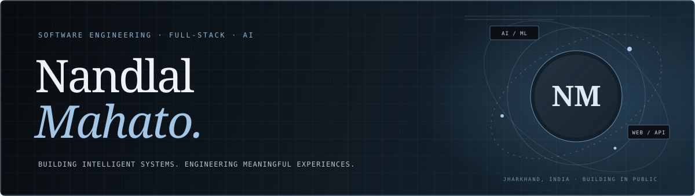
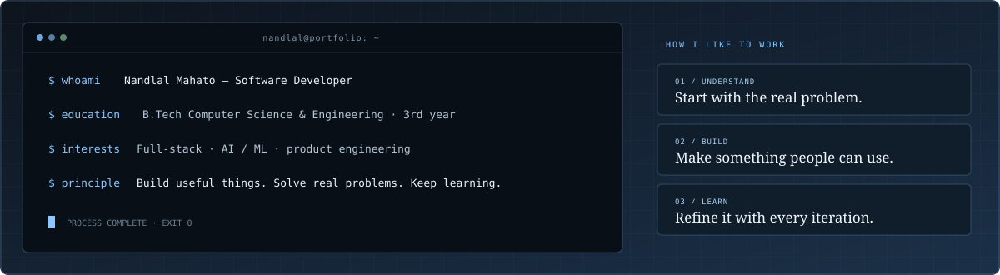
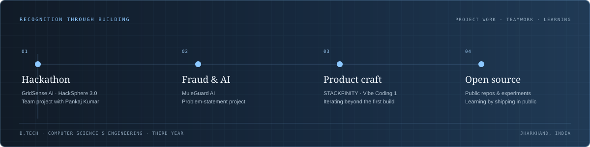
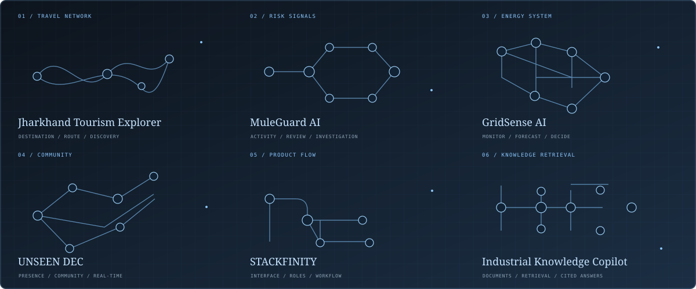
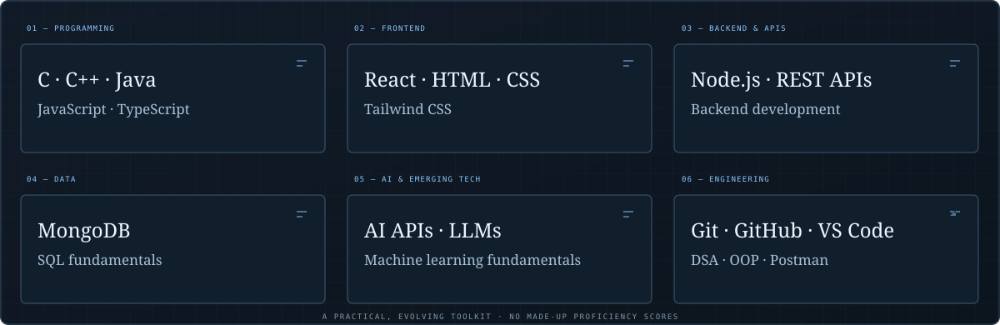
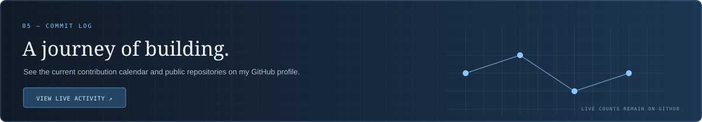

  
    
  
  
  
  

 

SOFTWARE ENGINEERING &nbsp;·&nbsp; FULL-STACK DEVELOPMENT &nbsp;·&nbsp; AI / ML

## `01` — About

  

I’m **Nandlal Mahato**, a third-year B.Tech Computer Science and Engineering student from **Jharkhand, India**. I enjoy turning practical problems into useful software, working across interfaces, APIs, data, and AI integrations.

I learn by building: through team projects, hackathons, and independent experiments. I’m working toward a software engineering role where I can keep growing and contribute to products people rely on.

## `02` — Recognition through building

  

The milestones here are project work and learning experiences. I’ve left out rankings, awards, grades, work experience, and certificates that I can’t link to and verify.

## `03` — Selected work

  

| Project | What it explores | Links |
|:--|:--|:--|
| **Jharkhand Tourism Explorer** | Itinerary planning, destination discovery, and practical local travel utilities. | [Live experience ↗](https://jharkhandtourismexplorer.netlify.app/) |
| **MuleGuard AI** | An AI-driven project developed around a mule-account and financial-fraud problem statement. | [Live demo ↗](https://muleguard-ai-frontend.vercel.app/) |
| **GridSense AI** | Smart energy microgrid and demand forecasting concept for **HackSphere 3.0**, built with Pankaj Kumar. | HackSphere 3.0 project · public link not listed |
| **UNSEEN DEC** | Anonymous community platform associated with Dumka Engineering College, with a web app and Android wrapper. | [Website ↗](https://unseendec.netlify.app/) · [Android repository ↗](https://github.com/Nandlal0001/unseen-android-apk) |
| **STACKFINITY** | A Vibe Coding 1 project continued beyond its initial hackathon build. | [Live demo ↗](https://vibe-1-stackfinity.vercel.app/) · [Repository ↗](https://github.com/Nandlal0001/stackfinity) |
| **Industrial Knowledge Copilot** | Retrieval-based answers with citations across manuals, logs, and permits. | [Repository ↗](https://github.com/Nandlal0001/industrial-knowledge-copilot) |

## `04` — Toolkit

  

A PRACTICAL, EVOLVING TOOLKIT · NO MADE-UP PROFICIENCY SCORES

## `05` — Commit log

  

GitHub’s native contribution calendar and current repository activity are shown on my [live profile ↗](https://github.com/Nandlal0001). No activity totals are hard-coded here.

## `06` — Education & learning

**B.Tech · Computer Science & Engineering · 3rd year**  
Jharkhand, India

Formal certifications will be listed here when there’s a verified credential to link.

## `07` — Connect

  
  

 

  

